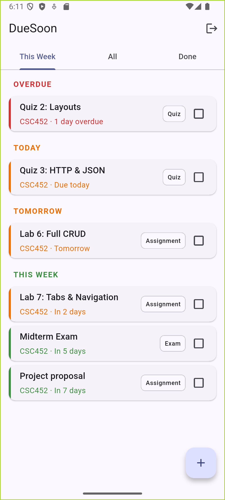
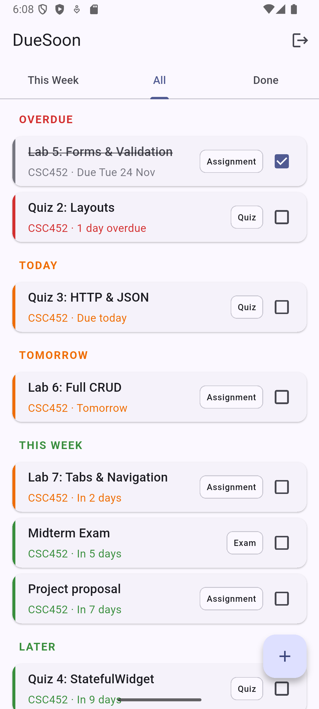
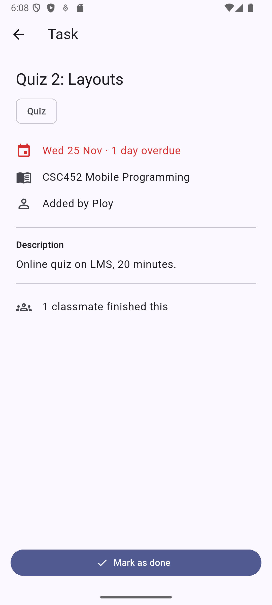
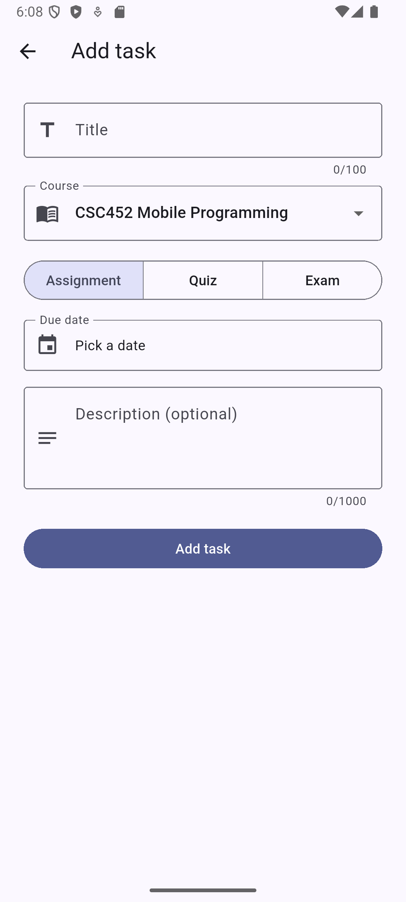
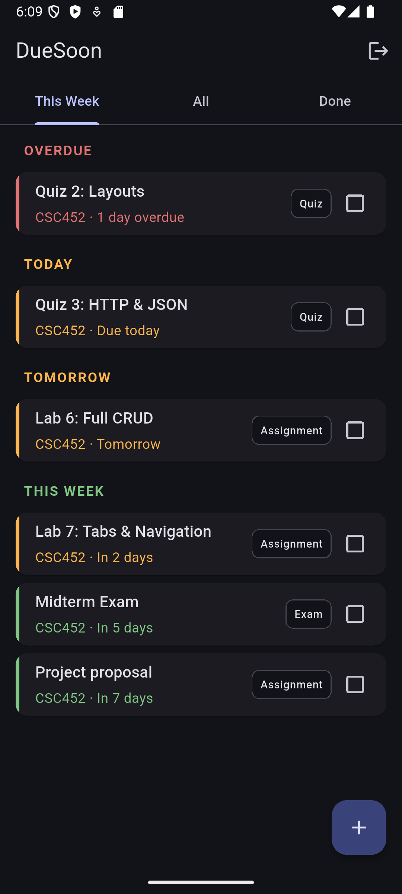
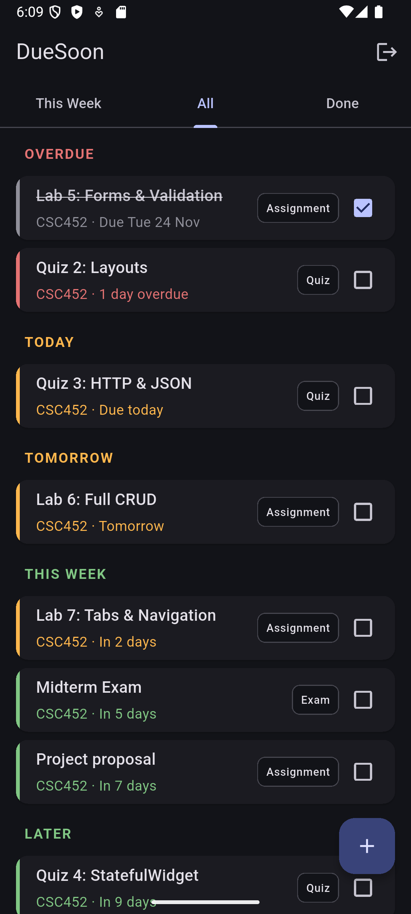
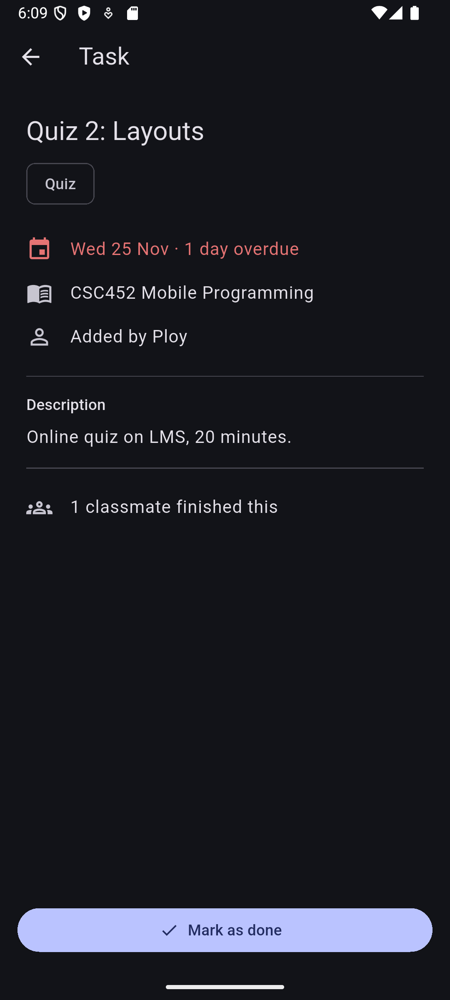
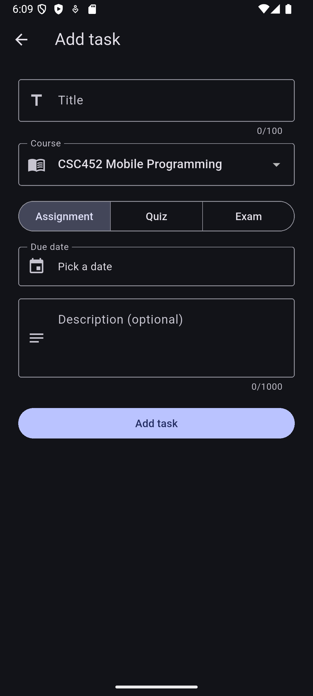

# DueSoon

A shared deadline board for one class. Anyone can post an assignment, quiz or exam; everyone sees it,
sorted by how soon it is due. Each student ticks off their own work, and sees how many classmates have
finished. Built for CSC452 Mobile Programming.

**Try it in a browser:** https://duesoon-web-phi.vercel.app (demo accounts below). Android: build the APK (see *Run it*).

| This Week | All (grouped) | Task detail | Add task |
|---|---|---|---|
|  |  |  |  |
|  |  |  |  |

More in [`docs/screenshots/`](docs/screenshots/) (splash, login, register; light + dark).

**Learning the code:** https://amm2049.github.io/duesoon/code-guide.html (source: [`docs/code-guide.html`](docs/code-guide.html)). It explains every file with its full code, step-by-step flows with line links, and a filter per team member ([`docs/TEAM.md`](docs/TEAM.md)).

## Features
- Register / log in (JWT; passwords hashed with bcrypt)
- Three tabs: **This Week** (overdue + next 7 days), **All**, **Done**, grouped Overdue / Today / Tomorrow / This week / Later with urgency colors
- Done is **per student**; the detail screen shows how many classmates finished
- Add a task (course, type, due date, description); only its creator can edit or delete it
- "Today" is always the **Bangkok** date, on the server and in the date picker
- Light and dark mode; pull to refresh; clear error messages (offline, session expired, validation)

## Stack
| Part | Tech | Where |
|---|---|---|
| App | Flutter 3.50 (Dart 3.14), `http`, setState | `app/` |
| API | Node 24, Express 5, CommonJS JavaScript | `api/` → https://duesoon-api.vercel.app |
| Database | Neon Postgres via Prisma 7 | |
| Auth | `jsonwebtoken` + `bcryptjs` | |

Design decisions (with reasons) are logged in [`docs/SPEC.md`](docs/SPEC.md) §2 as D-01…D-48.

## Run it

### API (`api/`)
```bash
npm install                 # also runs prisma generate
cp .env.example .env        # fill in the Neon URLs + JWT_SECRET (see comments in the file)
npx prisma db push          # create tables
npx prisma db seed          # demo data (dates relative to today)
npm run dev                 # http://localhost:3000
```

### App (`app/`)
```bash
flutter pub get
flutter emulators --launch Medium_Phone_API_35
flutter run                 # uses the live API by default
```
Release APK: `flutter build apk --release` → `build/app/outputs/flutter-apk/app-release.apk`.

### Demo accounts
`mai@duesoon.test`, `ploy@duesoon.test`, `ton@duesoon.test`, `beam@duesoon.test`, password `demo1234`.

## API
All routes except `/`, `/register`, `/login` need `Authorization: Bearer <token>`. JSON is snake_case; dates are `"YYYY-MM-DD"`.

| Method | Path | Does |
|---|---|---|
| GET | `/` | health check |
| POST | `/register`, `/login` | returns `{token, user}` |
| GET | `/me` | who the token belongs to |
| GET | `/courses` | course list |
| GET | `/tasks?filter=week\|all\|done` | tasks with `days_left`, `done`, `done_count` |
| GET / POST / PUT / DELETE | `/tasks/:id`, `/tasks` | read / create / edit / delete (edit & delete: creator only → 403) |
| POST / DELETE | `/tasks/:id/done` | mark done / not done for me |

Full contract: SPEC §4.

## Tests
| Where | Command | What |
|---|---|---|
| `api/` | `npm test` | 31 unit tests (dates, validation), no DB |
| `api/` | `npm run test:api` | 25 HTTP tests against the real DB (cleans up its `apitest-*` users) |
| `app/` | `flutter test` | 69 unit + widget tests (validators, API client with a mock server, screens) |
| `app/` | `flutter analyze` | lint / type check |

## Folders
```
api/   src/ (index.js = Vercel entry, routes/, repos/ = all Prisma calls, lib/, middleware/)
       prisma/ (schema, seed)   test/   test-api/
app/   lib/ (screens/, widgets/, services/, models/, utils/)   test/
docs/  SPEC.md (source of truth)   DEMO.md   screenshots/
```
